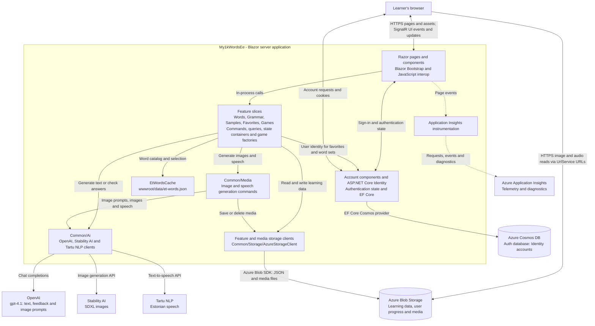
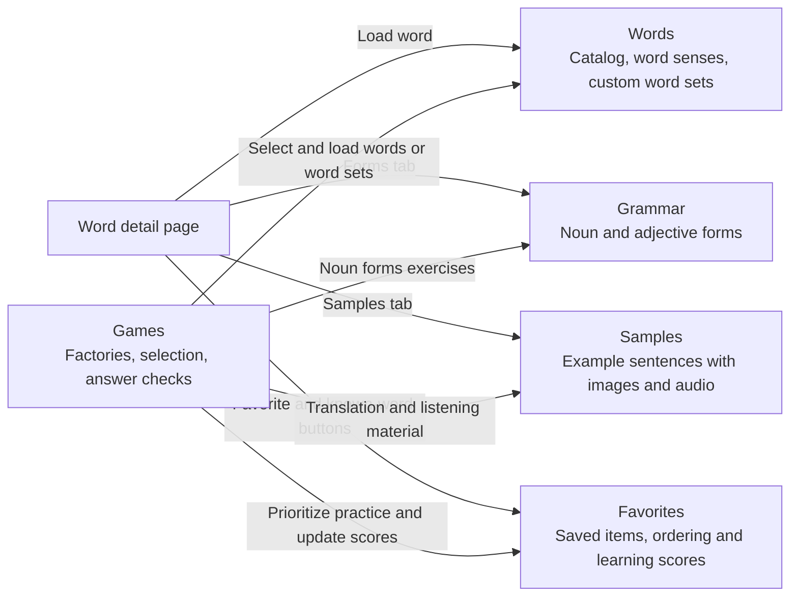

# ai-flashcards

- Exercises for Estonian words and sentences memoization
- [Demo](https://youtu.be/ugRFUHiGXPc?si=sIdP3VqwOtmoAZzx)

## ./My1kWordsEe

- current development
- https://my-1k-ee.azurewebsites.net/
- `gpt-4.1` for texts
- [stability.ai](https://platform.stability.ai/docs/api-reference#tag/SDXL-and-SD1.6) for images
- [tartu nlp](https://neurokone.ee/) for speech
- [blazor](https://dotnet.microsoft.com/en-us/apps/aspnet/web-apps/blazor) + [blazor bootstrap](https://demos.blazorbootstrap.com/)

## Architecture and communication

This is a **single .NET 10 Blazor Web App**, not a collection of microservices. Interactive pages run on the server; the browser sends UI events and receives rendering updates over a Blazor SignalR circuit. Features use **Command and Query Separation (CQS)** and dependency injection to call C# services directly, rather than calling a separate REST backend.

### Runtime overview

Arrows describe calls or data access, with responses omitted unless shown as bidirectional. Everything inside the application boundary runs in the same server process. External AI and storage calls use server-side credentials; the browser reads generated media directly from Blob Storage URLs.



**Important boundaries:** Cosmos DB stores Identity records, not the learning catalog or favorites. Blob Storage holds both application JSON data and media. `UrlService` resolves media paths against the blob endpoint; it does not proxy media through the app or generate signed URLs. Deployments must make the intended media readable by the browser without exposing private learning data. `SaladAiClient` exists in the source but is not registered in the application's active DI pipeline.

### How the feature slices collaborate

This view expands the feature box above. Arrows show dependencies or UI composition, not separate network services. Shared AI, media and storage dependencies are omitted here to keep the feature relationships readable.



Each slice under [`Feature/`](My1kWordsEe/Feature) keeps its models and relevant commands, queries, storage clients, state containers, pages or components together. Commands and storage clients are generally singleton services; favorites/word-set state and game factories are scoped to the interactive circuit. These in-memory objects are not the persistent store.

| Stored information | Location |
| --- | --- |
| Base word catalog loaded by `EtWordsCache` | App file: `My1kWordsEe/wwwroot/data/et-words.json` |
| Generated word senses, grammatical forms and example sentences | Blob containers: `et-word`, `et-forms`, `et-samples` |
| Per-user favorites/learning scores and custom word sets | Blob containers: `favorites`, `word-sets` |
| Reusable generated game content | Blob container: `cached-games` |
| Speech, images and image prompt text | Blob containers: `audio` (WAV), `image` (JPG and TXT) |
| Accounts and Identity records | Cosmos database: `Auth`; container: `ApplicationDbContext` |

### Representative user flows

1. **Look up a word:** a Words page calls `GetOrAddEtWordCommand`. It checks stored word data first; on a miss, `AddEtWordCommand` asks OpenAI for word senses, generates pronunciation through Tartu NLP, and persists the result. Grammar forms use a similar read-before-generate flow.
2. **Generate an example:** `AddEtSampleSentenceCommand` asks OpenAI for a sentence, then coordinates image and speech generation. The image path uses OpenAI to write a prompt and **Stability AI to generate the actual image**. JSON and media are saved to Blob Storage; the browser loads the returned media URLs.
3. **Practice and track progress:** Games select words from the catalog, favorites or custom sets, depending on the exercise. Factories reuse or generate the needed words, samples, forms or cached game content. Translation/listening checks can call OpenAI; other games use local comparisons. Supported game results update scores through `FavoritesStateContainer`, which persists them via favorites commands.

### Repository map and supporting dependencies

| Project or directory | Responsibility and relationship |
| --- | --- |
| [`My1kWordsEe/Program.cs`](My1kWordsEe/Program.cs) | Start here: DI registrations, required secrets, Blazor hosting, Identity/Cosmos configuration and telemetry. `Main` ensures the auth database exists before serving requests. |
| [`My1kWordsEe/Components/`](My1kWordsEe/Components) | Application shell, routing, navigation, shared pages and account UI. Feature-specific UI lives with its slice. |
| [`My1kWordsEe/Feature/`](My1kWordsEe/Feature) | The five learning feature slices shown above. Start with a page, then follow its injected commands, state containers or game factory. |
| [`My1kWordsEe/Common/`](My1kWordsEe/Common) | Shared AI adapters, media generation/storage, Blob Storage facade and helpers. |
| [`My1kWordsEe/AuthData/`](My1kWordsEe/AuthData) | Identity user model and EF Core Cosmos mappings. The registered email sender is a no-op, not a production email integration. |
| [`My1kWordsEe.Cmd/`](My1kWordsEe.Cmd) | Developer console utility referencing the web project and reusing `BuildWebHost`/DI for data-generation routines. Calls in `Main` are currently commented out; it is not a running background worker. |
| [`My1kWordsEe.Tests.Unit/`](My1kWordsEe.Tests.Unit) | xUnit tests referencing the app; Moq is available for substituting dependencies. Not a runtime dependency. |
| [`My1kWordsEe.Tests.E2E/`](My1kWordsEe.Tests.E2E) | NUnit/Playwright browser tests referencing the app and starting it with `BuildWebHost`. The shared fixture uses the real service registrations, so secrets and reachable services are required for exercised integrations. |
| [`source-data/`](source-data) and [`scripts/`](scripts) | Seed word lists and developer data-maintenance scripts. The app loads its packaged JSON catalog, not this source directory directly. |
| [`.github/workflows/`](.github/workflows) | Test/coverage automation and deployment. The deployment workflow builds/publishes the web app after a successful Playwright workflow on `main`, then deploys to Azure App Service `my-1k-ee`. |

The console and both test projects depend on the web project, **not the other way around**. Production serves the web application; the supporting projects are development/test tools. Package versions are centralized in [`Directory.Packages.props`](Directory.Packages.props).

## Local setup

- [dotnet 10](https://dotnet.microsoft.com/en-us/download/dotnet/10.0)
- setup the api keys

```
dotnet user-secrets set "Secrets:StabilityAiKey" "XYZ"
dotnet user-secrets set "Secrets:OpenAiKey" "XYZ"
dotnet user-secrets set "Secrets:AzureCosmosConnectionString" "XYZ"
dotnet user-secrets set "Secrets:AzureBlobConnectionString" "XYZ"
dotnet user-secrets set "Secrets:AppInsightsConnectionString" "XYZ"
```

## ./source-data

- most used Estonian words utilized as seed data to generate initial app content
